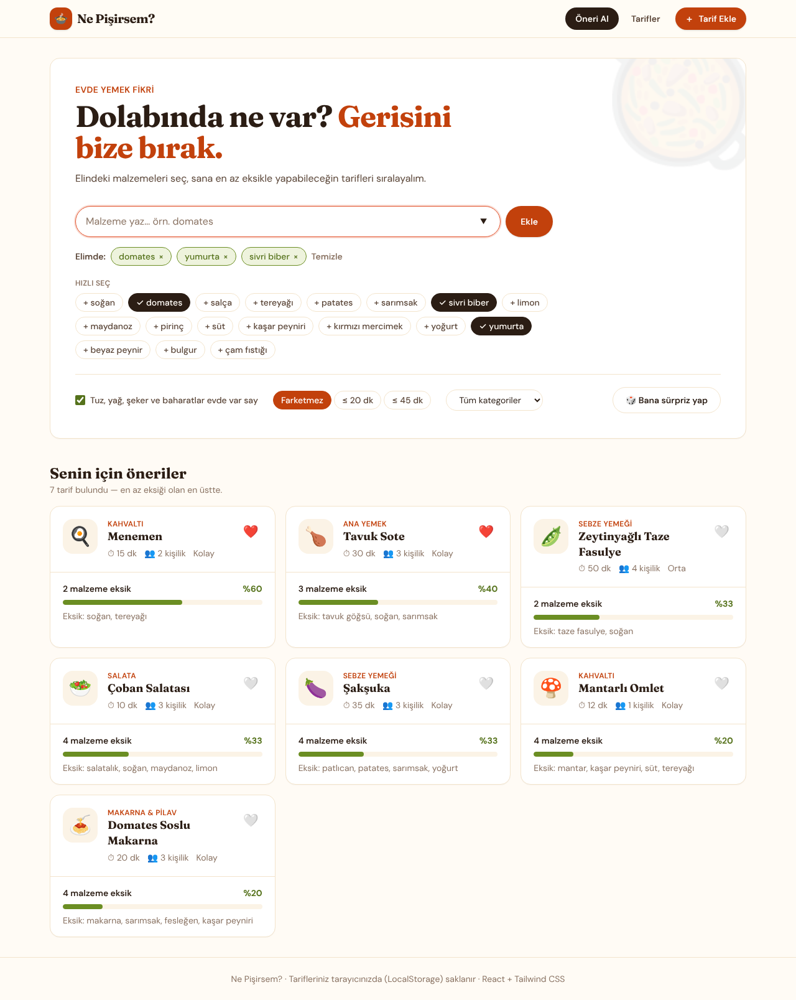
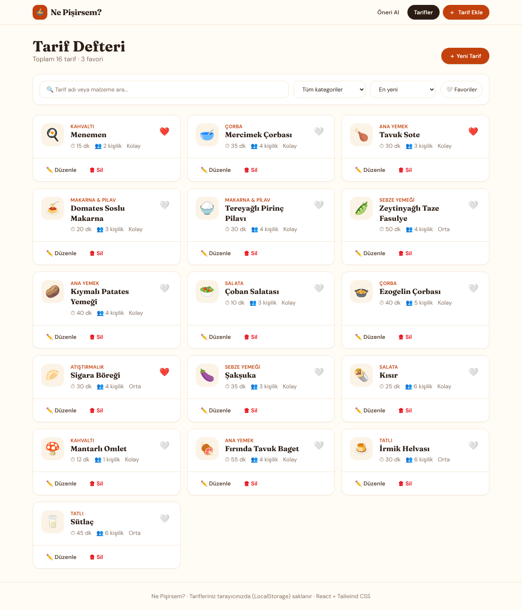
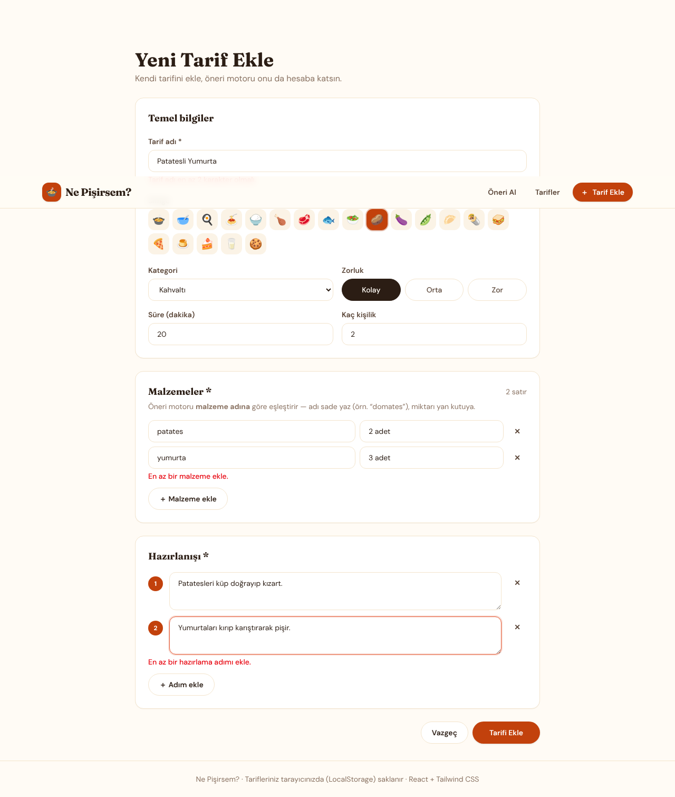
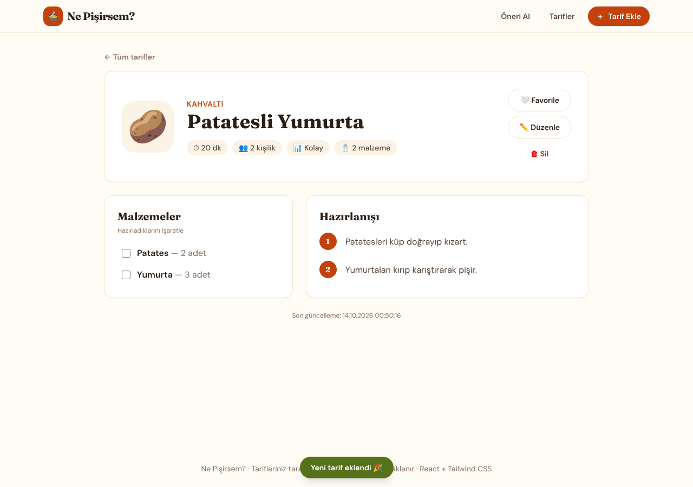
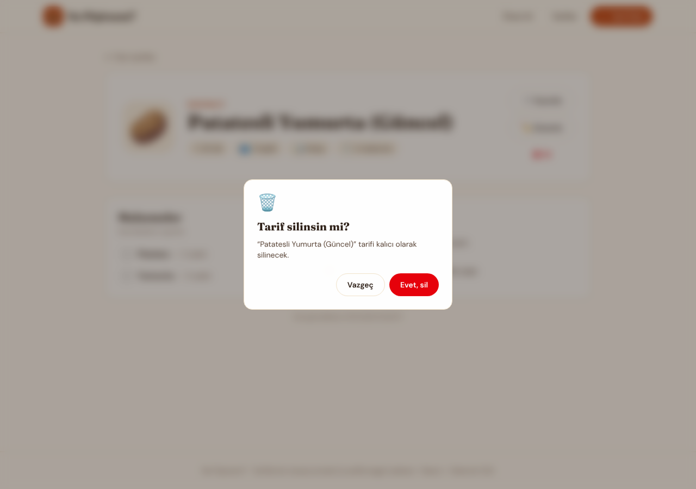
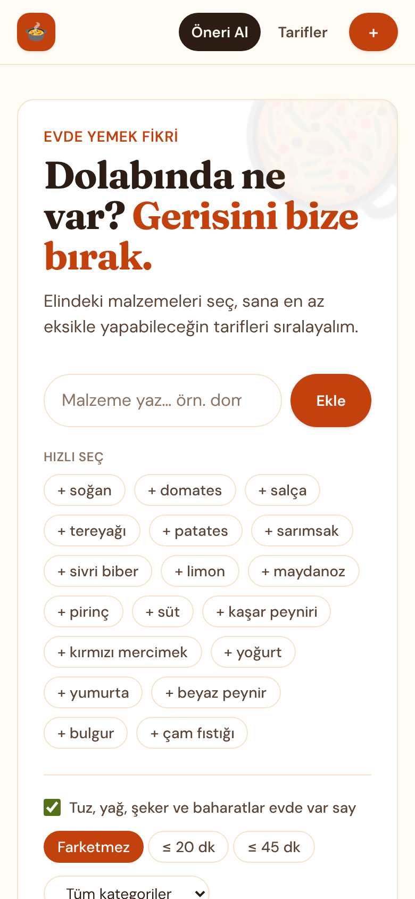
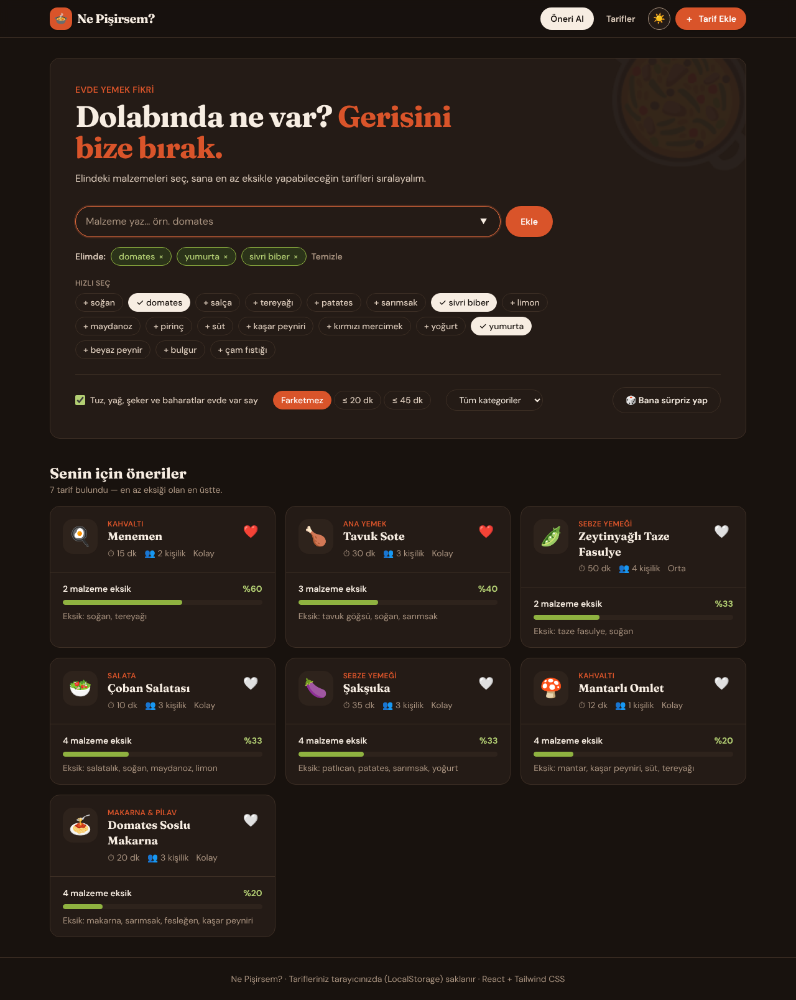
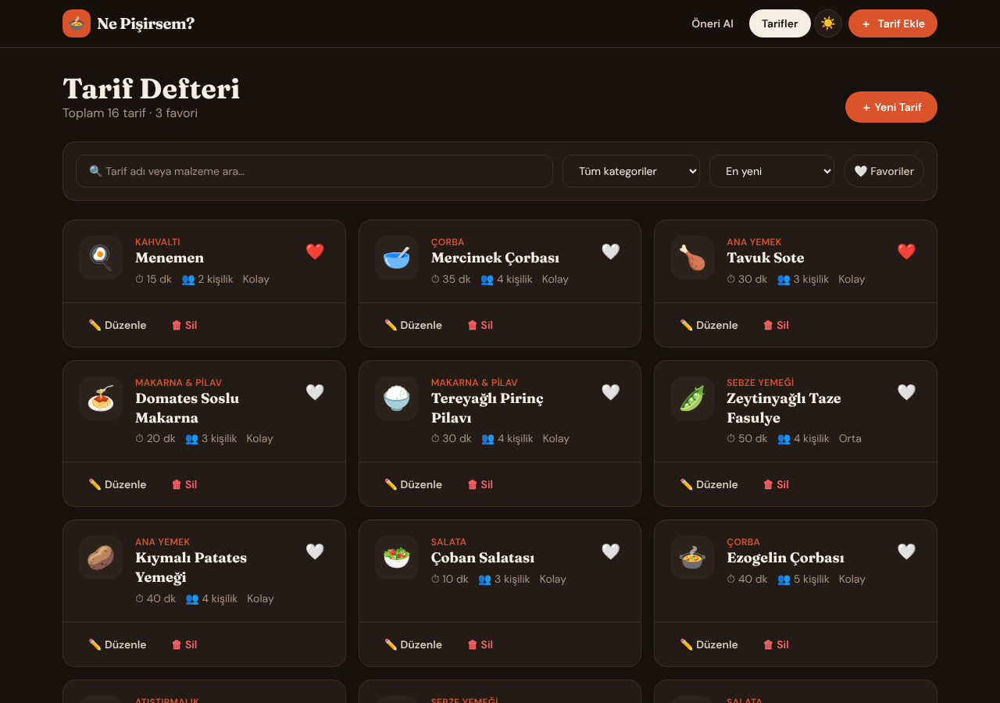

# 🍲 Ne Pişirsem?

Evde yemek yapmak isteyen ama **ne yapacağına karar veremeyenler** için yemek öneri uygulaması.
Dolabındaki malzemeleri seçersin; uygulama tarifleri **en az eksik malzemeyle** yapılabilecek olandan başlayarak sıralar.
Kendi tariflerini ekleyebilir, düzenleyebilir ve silebilirsin — tüm veriler tarayıcının **LocalStorage**'ında saklanır.

> **Canlı demo:** `https://<site-adin>.netlify.app` ← Netlify'a yükledikten sonra buraya kendi linkini yaz.



---

## ✨ Özellikler

| Özellik | Açıklama |
|---|---|
| 🥕 **Malzemeye göre öneri** | Elindeki malzemeleri yaz veya "Hızlı seç" çiplerinden seç; her tarif için eşleşme yüzdesi ve eksik malzemeler gösterilir. |
| 🧂 **Temel malzeme seçeneği** | Tuz, yağ, şeker, baharat gibi her evde bulunanlar hesaba katılmayabilir. |
| ⏱ **Süre & kategori filtresi** | "≤ 20 dk", "≤ 45 dk" ve kategoriye göre daraltma. |
| 🎲 **Bana sürpriz yap** | Kararsız kalanlar için rastgele tarif. |
| ❤️ **Favoriler** | Tarifleri favorile, listede sadece favorileri göster. |
| 🔍 **Arama & sıralama** | Tarif adı veya malzemeye göre arama; yeniye, süreye, alfabeye göre sıralama. |
| 🌙 **Karanlık mod** | Navbar'daki 🌙/☀️ düğmesiyle tema değişir; seçim hatırlanır, seçim yoksa sistem teması izlenir. |
| 📱 **Duyarlı tasarım** | Mobil, tablet ve masaüstünde düzgün görünüm. |

### CRUD işlemleri

| İşlem | Nerede? | Kod |
|---|---|---|
| **Ekle** (Create) | `/tarif/yeni` — form doğrulamalı yeni tarif | `addRecipe()` → `src/context/RecipeContext.tsx` |
| **Listele** (Read) | `/tarifler` — arama/filtreli liste, `/tarif/:id` detay | `recipes`, `getRecipe()` |
| **Güncelle** (Update) | `/tarif/:id/duzenle` — mevcut veriyle dolu form | `updateRecipe()` |
| **Sil** (Delete) | Liste kartı veya detay sayfası → onay penceresi | `deleteRecipe()` |

---

## 🛠 Kullanılan Teknolojiler

- **React 19** + **TypeScript** — arayüz ve tip güvenliği
- **Vite** — geliştirme sunucusu ve derleme
- **Tailwind CSS v4** — stil
- **React Router** — sayfa yönlendirme
- **LocalStorage** — kalıcı veri (özel `useLocalStorage` hook'u)
- **Context API** — global tarif ve bildirim (toast) yönetimi
- **Netlify** — yayın

## 📁 Klasör Yapısı

```
ne-pisirsem/
├── public/
│   ├── _redirects            # Netlify SPA yönlendirmesi
│   └── favicon.svg
├── screenshots/              # README ekran görüntüleri
├── src/
│   ├── components/           # Tekrar kullanılabilir bileşenler
│   │   ├── ConfirmDialog.tsx    # Silme onay penceresi
│   │   ├── EmptyState.tsx       # Boş durum kutusu
│   │   ├── IngredientPicker.tsx # "Dolabımda ne var?" çip seçici
│   │   ├── Layout.tsx           # Navbar + footer
│   │   ├── RecipeCard.tsx       # Tarif kartı (eşleşme çubuğu dahil)
│   │   └── RecipeForm.tsx       # Ekle/Güncelle ortak formu
│   ├── pages/                # Sayfalar (route'lar)
│   │   ├── HomePage.tsx         # Öneri ekranı
│   │   ├── RecipesPage.tsx      # Listeleme + silme
│   │   ├── RecipeDetailPage.tsx # Tarif detayı
│   │   ├── RecipeFormPage.tsx   # Ekle / Güncelle
│   │   └── NotFoundPage.tsx
│   ├── interfaces/           # TypeScript tipleri
│   │   └── Recipe.ts
│   ├── context/              # Global state (CRUD fonksiyonları burada)
│   │   ├── RecipeContext.tsx
│   │   └── ToastContext.tsx
│   ├── hooks/
│   │   ├── useLocalStorage.ts
│   │   └── useTheme.ts          # Açık / karanlık tema
│   ├── data/                 # Örnek tarifler ve form varsayılanları
│   ├── utils/
│   │   └── matching.ts          # Öneri (eşleştirme) algoritması
│   ├── App.tsx
│   ├── main.tsx
│   └── index.css             # Tailwind + tema renkleri
├── netlify.toml
└── package.json
```

## 🧠 Öneri Algoritması Nasıl Çalışır?

`src/utils/matching.ts`:

1. Kullanıcının malzemeleri ve tarif malzemeleri Türkçe karakterlere uygun şekilde küçük harfe çevrilir (`toLocaleLowerCase('tr-TR')`).
2. Kelime başı eşleşmesi yapılır: `tavuk` → `tavuk göğsü`, `mercimek` → `kırmızı mercimek` eşleşir; `su` → `sucuk` eşleşmez.
3. "Temel malzemeler evde var" açıksa tuz, yağ, baharat gibi malzemeler hesaba katılmaz.
4. **Skor = eşleşen malzeme / tarifin toplam malzemesi.** Sonuçlar skora, sonra eksik sayısına, sonra süreye göre sıralanır.

---

## 🌙 Karanlık Mod Nasıl Çalışır?

- Renkler `src/index.css` içinde **CSS değişkeni** olarak tanımlıdır (`--color-cream-50`, `--color-ink-900` …).
- `<html>` etiketine `dark` sınıfı eklenince `.dark { … }` bloğu bu değişkenleri koyu tonlarla ezer — bileşenlerin hiçbirine tek tek `dark:` yazmak gerekmez.
- `src/hooks/useTheme.ts` seçimi LocalStorage'a kaydeder; seçim yoksa işletim sisteminin tercihini (`prefers-color-scheme`) izler.
- `index.html`'deki küçük script tema sayfa çizilmeden uygulandığı için karanlık modda beyaz "flaş" görünmez.

## 🚀 Kurulum ve Çalıştırma

Gereksinim: **Node.js 20+**

```bash
git clone https://github.com/<kullanici-adin>/ne-pisirsem.git
cd ne-pisirsem
npm install
npm run dev        # http://localhost:5173
```

Diğer komutlar:

```bash
npm run build      # dist/ klasörüne üretim derlemesi
npm run preview    # derlenmiş sürümü yerelde dene
npm run lint       # kod kontrolü
```

## 🌐 Netlify ile Yayına Alma

**Yöntem 1 — GitHub'a bağlayarak (önerilen):**
1. [app.netlify.com](https://app.netlify.com) → **Add new site → Import an existing project → GitHub**
2. `ne-pisirsem` reposunu seç.
3. Ayarlar `netlify.toml`'dan otomatik gelir (Build: `npm run build`, Publish: `dist`). **Deploy**'a bas.
4. Her `git push` sonrası site otomatik güncellenir.

**Yöntem 2 — Sürükle bırak:**
`npm run build` çalıştır, oluşan `dist` klasörünü [app.netlify.com/drop](https://app.netlify.com/drop) sayfasına sürükle.

> `public/_redirects` ve `netlify.toml` sayesinde `/tarifler` gibi sayfalarda yenileme yapınca 404 hatası alınmaz.

---

## 📸 Ekran Görüntüleri

| Tarif listesi | Tarif ekleme |
|---|---|
|  |  |

| Tarif detayı | Silme onayı | Mobil |
|---|---|---|
|  |  |  |

**Karanlık mod**

| Öneri ekranı | Tarif listesi |
|---|---|
|  |  |

---

## 🎯 Proje Kazanımları

- HTML, CSS ve JavaScript temellerinin uygulanması
- Tailwind CSS kurulumu ve bileşen tabanlı stil
- React ile bileşen, sayfa, hook ve context mimarisi
- LocalStorage ile kalıcı CRUD işlemleri
- GitHub ile sürüm kontrolü ve Netlify ile yayınlama

## 👤 Geliştirici

**Umut Barbaros BABAHAN** — OSTİM Teknik Üniversitesi, Yapay Zeka Mühendisliği
